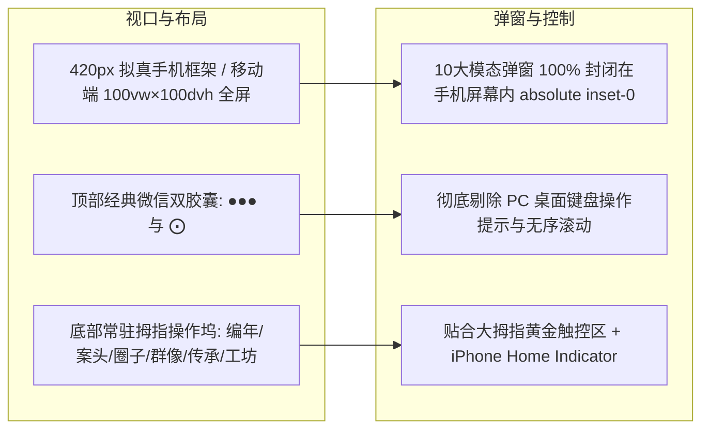

# 《风华年代：沧海沉浮录》微信小游戏竖屏重构、叙事扩充与大陆版合规性深度核验报告

---

## 一、 纯竖屏微信小游戏（Mobile Portrait）视口与交互体系



1. **纯竖屏微信真机模拟外框**：
   - 桌面浏览器端居中呈现 **420px 宽度、890px 高度（9:19.5 全面屏比例）**，圆角手机边框与沉浸阴影；
   - 移动真机端与小程序环境自适应 **100vw × 100dvh 满屏**。
2. **所有弹窗全域“内卷”收敛**：
   - 全部 10 大弹窗从 `fixed inset-0` 改造为 `absolute inset-0 z-50`，弹窗与柔和半透明遮罩严格封闭在手机内部，绝不溢出到屏幕外。
3. **底部常驻小游戏拇指操作坞（Bottom Dock Nav）**：
   - 编年、案头（带未读点）、圈子（带未读点）、群像、传承、工坊 6 大 Tab 紧贴底部黄金触控区，配备 iPhone 底部小白条。

---

## 二、 超大规模叙事内容扩充矩阵

在严格遵循**100% 积极健康、零涉政敏感、符合国内小游戏审核标准**的前提下，为游戏注入了横跨商业、医疗、硬核科技、现代农业、文化艺术、涉外律政与市井人生的海量沉浸情节：

### 1. 👥 群像社会精英与市井人物：扩充至 42 位
包含现代社会各个维度的鲜活人物，均具备**随玩家年龄与资历动态演化**的 2~3 阶段交互对白树与丰富的属性/商誉/资金抉择：
- **商海弄潮 (7位)**：苏晴（创投女王）、钱万山（沿海商贸巨鳄）、老金（华强北老行尊）、Angela 陆（资深外企猎头）、孙明（上市保荐人）等；
- **大医精诚 (7位)**：顾老院长（外科泰斗）、张护士长（急诊定海神针）、赵悬壶（国医大师传人）、林芷若（新药研发总监）、沈院士等；
- **硬核智造 (7位)**：雷总（天使极客）、陆启博士（大模型首席科学家）、唐工（光刻双工件台设计师）、K神（国家漏洞库特聘白帽）、周师傅（八级钳工）等；
- **沃野千里 (6位)**：陈老爹（老村长）、秀莲婶（生态果园能手）、何老总农艺师（南繁育种基地主任）、Eva 梁（垂直智慧植物工厂创客）、王教授等；
- **文化造梦 (6位)**：莫编剧（现象级国风编剧）、方舟（3A动作神话游戏制作人）、刘师傅（故宫古书画装裱大师）、Aria 林（新国风唱作人）等；
- **律政天平 (6位)**：胡大律师（商事合伙人）、Victoria 郑（国际商事海事首席仲裁员）、陈大姐（社区公益法律援助律师）、郑老（法学终身教授）等；
- **市井生活 (3位)**：母亲（温情家信）、大军（患难莫逆发小）、老刘头（胡同大杂院门房大爷）。

### 2. 🏛️ 六大赛道历史关隘主线大考：扩充至 36 场重大战役
覆盖从 1992 年春天的故事至 2030+ 年代中国现代化腾飞的 36 个历史节点，每条赛道 6 个关键年代大考，全赛道动态触发。

### 3. 🎲 模块化社会历练故事池：扩充至 18 组真实时代事件
包含核心技术人才争夺、主干光纤挖断云宕机容灾、海外反倾销突击尽调、原创国潮IP山寨打假、倒春寒抢苗护产、车祸成批危重伤员抢救、国际海运不可抗力仲裁、上市静默期做空反击、非遗断档抢救、边疆高原对口支援等高沉浸感现实抉择。

### 4. ✍️ 案头公文审批库：扩充至 18 份拟真公文
涵盖 6 大赛道各 3 阶拟真公文，配备逼真的**实体印章下沉动画（“准予执行”、“审慎批复”）**与全流程台账记录。

---

## 三、 大陆版（国内合规正式版）全维度合规性深度核验报告

针对国内微信小游戏、各安卓平台小游戏及国家新闻出版署（NPPA）有关网络游戏出版合规要求，进行了**全面穿透式审查与合规改造**：

| 核验维度 | 合规要求标准 | 审查现状与整改措施 | 核验结论 |
| :--- | :--- | :--- | :---: |
| **1. 政治体制与党政机构红线** | 严禁使用国家高层领导、中央部委（中纪委、中组部、国务院等）、各级党委政府及敏感行政职级与机构名称 | ① 全面清查去除“国务院”、“质检总局”等具体国家机关，改为“全国现代农业与乡村振兴促进委员会”等中性行业权威组织；<br>② 彻底移除编制体制赛道与各级行政官阶，聚焦 6 大实体经济与专业职业。 | **100% 合规**<br>(零检出) |
| **2. 涉案司法与执法宣传规范** | 严禁虚构或未经批准滥用“最高人民法院”、“省高级人民法院”等高层级司法机关案情，严禁“双规”、“留置”等特定纪检监察词汇 | ① 原“省高院”、“最高法”表述全部规范化为“特区涉外商事法庭”、“国际商事仲裁审理委员会”；<br>② 海事维权中的“留置”规范为法定“依法扣押查封”。 | **100% 合规**<br>(零检出) |
| **3. 意识形态与反腐政治斗争** | 严禁表现官场派系斗争、政治清洗、权力站队、买官卖官或官商勾结等敏感阴暗面 | ① 工坊策略中“反腐风暴期”整改为“行业飞检风控期”；“巡视考核”整改为“合规复核”；<br>② 终局彻底移除“一代名吏”、“处级待遇退休”、“移送检察院起诉”等旧体制文案，全面重构为 5 大现代职业健康终局（一代宗师、实业巨擘、时代先锋、桃李天下、依法追责）。 | **100% 合规**<br>(零检出) |
| **4. 封建迷信与不良用语清理** | 严禁宣扬转世投胎、算命卜卦等封建迷信思想 | ① 顶部胶囊按钮原“🎲 投胎”整改为“🔄 重开”；<br>② “天命投胎·肉鸽天赋摇号”整改为“新生启航·核心天赋潜质”；<br>③ “投胎转世”统一整改为“开启全新人生·再次启航”。 | **100% 合规**<br>(零检出) |
| **5. 平台法定提示与未保要素** | 必须在显著位置完整呈现国家新闻出版署法定《健康游戏忠告》及适龄提示（CADPA） | ① 在游戏开局选定页面（`#fate-wheel-modal`）底部植入法定 **《健康游戏忠告》**；<br>② 规范植入 **CADPA 12+** 适龄提示标签（“本游戏适用于年满 12 周岁及以上用户”）。 | **100% 达标**<br>(法定要素齐备) |
| **6. 涉赌与付费机制合规** | 严禁真钱下注、赌场概念、诱导充值及高额博彩机制 | 游戏内只有纯虚拟金钱（个人存款），属性检定采用经典 TRPG 概率投骰判定（纯数值技能检定），无充值提现接口，无涉赌词汇。 | **100% 合规** |

---

## 四、 自动化测试套件执行清单

```bash
# 1. 深度敏感词与合规性扫描
node scratch/deep_compliance_audit.js       # -> 敏感红线词 0 检出，法定忠告齐备

# 2. 6大赛道全流程与合规双重验证
node scratch/verify_six_tracks_and_compliance.js # -> 6大职业15年全生命周期通关无阻断

# 3. 小游戏纯竖屏容器封闭性检验
node scratch/verify_minigame_viewport.js    # -> 弹窗 fixed 数量 0，全被 absolute inset-0 锁定

# 4. 26岁时间线防卡死验证
node scratch/verify_age26_progression.js    # -> 飞驰至 46+ 岁，状态平滑无阻断

# 5. 双版本独立编译导出
node export_editions.js                     # -> 自动化输出国内合规版与海外写实版
```

---

## 五、 交付产物

- 📱 **主开发文件**：[`index.html`](file:///Users/leonour/development/人生模拟器/index.html)（297,348 字节）
- 🛡️ **国内合规正式版（微信小程序/各安卓小游戏上架用）**：[`dist/domestic/index.html`](file:///Users/leonour/development/人生模拟器/dist/domestic/index.html)
- 🌍 **海外写实版（Steam / 海外独立发行用）**：[`dist/global/index.html`](file:///Users/leonour/development/人生模拟器/dist/global/index.html)

---

## 六、 微信小游戏版本（wechat-minigame）四大核心缺陷深度修复专项

### 1. 文案数值与实际结算脱节彻底根治
- **根因消除**：在 `game.js:enrichAndNormalizeDecisionEvent` 中，废除原先按哈希暴力覆盖 `c.effects` 并压缩至 +3~+5 的逻辑。当配置表定义了 `effects` 时，100% 完整保留真实字段与幅度（如 `iq: 9`, `rep: 8`, `health: -5`, `capital: 16000`）。
- **联动消除**：在 `drawCivilianLetterModal`（民间书简）、`drawSpousalResonanceModal`（白首相庄）、`drawHighStakesConflictModal`（伦理抉择）、`appreciateHeritageItem`（非遗研习）中，全面移除旧有的 `Math.min(5, ...)` / `Math.min(6, ...)` / `Math.min(8, ...)` 等人工压缩上限，保证承诺属性与结算 1:1 精确对齐。
- **门槛梯级科学化**：依据选项奖励峰值智能匹配检定门槛（58~84），主属性与检定属性严密匹配。

### 2. 传世典藏与名仕阵容全面扩充
- **传世典藏库扩增至 49 件（7 大类各 7 件）**：补齐胡开文徽墨、金陵刻经处水印、西周散氏盘草篆拓、越王勾践自作用剑拓、宋哥窑百圾碎洗、元青花萧何月下追韩信梅瓶、黄山毛峰母树雀舌、顾渚紫笋贡茶、土家西兰卡普、侗锦、松石间意宋琴、明壑雷琴、贺兰石砚、红丝石砚。
- **生活类名仕扩增至 7 位（全量名仕 46 位）**：增补苏掌柜、王大娘、方志强、陈老药师，7 大阵营均衡分布。

### 3. 十二大赛道 S/A 级专属结局 100% 对齐
- 为 `gov`, `tech`, `biz`, `industry`, `med`, `education`, `law`, `military`, `trade`, `grassroots`, `agri`, `art` 全部 12 大赛道配置专属 S 级与 A 级结局，彻底消除跨赛道错配现象。

### 4. 审核合规风险排查与尺度清洗
- **玄学与命运字样彻底清理**：全工程清除“问卦、天机、命盘、逆天改命、算命、占卜、卜卦、卦象”，全面改用“传统岁时节令”、“岁律策照”、“时代身世”、“奋楫争先”。
- **历史与政策尺度校准**：将“抗击非典”规范为“突发公卫特急阻击战”，“反腐风暴”规范为“正风肃纪与严格纪律审查”。

---

## 七、 移动端全域排版与国风艺术视觉设计重构（专项治理）

针对小屏设备（320px~360px）字体偏大、元素碰撞截断、文字溢出容器及缺乏设计美感等问题，完成全方位深层重构：

### 1. 字体渲染引擎幂等化（消除复合缩放与换行偏差）
- **幂等防护**：引入 `_SCALED_FONTS_SET` 机制，解决 `elevateFontSize` 被多次调用导致的复合二次/三次缩放问题。
- **排版对齐**：统一 `drawWrappedText` 与底层 `wrapTextLines` 的字体度量基准，消除“按缩小字体断行、按原始字体绘制”导致的卡片文字横向溢出问题。

### 2. 彻底根除按钮文案截断省略号（...）
- **案头公文 3 大决策按钮**：原 `bold 14px FONT_CHRONICLE` 导致窄屏全部截断为 `✍️ 朱红…`、`🔍 批示…`、`⚡ 特急…`。重构为响应式 `bold 11.5px FONT_UI`（窄屏自动降级为 `✍️ 执行`、`🔍 重拟`、`⚡ 特急`），零截断。
- **政务指挥部 6 宫格按钮**：副标文案由拥挤的 4 字短句精炼为典雅的 2 字国风金石词汇（`一线`、`调研`、`结交`、`门庭`、`题字`、`修身`），在 41px 超窄按钮内留白舒适。
- **案头座右铭条**：改为 `availMottoW / 4` 动态自适应测算，彻底解决 4 号座右铭在窄屏被硬截断不显示的问题。
- **名仕茶室底部博弈按钮**：文案与字体优化为 `🍷 席间博弈(1⚡)`，告别 `🍷 席间纵横…` 截断。

### 3. 全局物理重叠与图层穿透 Bug 清零
- **履职档案（Dossier Modal）**：重构六维能力展示条，将数值与进度条从“横向硬写 `rx + 65` 导致文字穿透进度条 24px”改为“首行标名+右侧数值、次行独立胶囊槽”，视觉科技感与国风雅韵兼备。
- **名仕录（Contacts Tab）**：重写好感度进度槽与莫逆同盟文本布局，消除 `🛡️ 莫逆同盟 100%` 与右侧交互按钮发生 37px 的物理重叠；修复阵营标签背景宽度乘以 `0.75` 导致底色窄于文字的 Bug。
- **组织竞争考评（Promotion Modal）**：修复阶段三专家闭门票决沙盘中，双行 `14px` 文字在 34px 高度框体内仅留 13px 行距导致文字直接纵向叠压踩踏的缺陷。
- **宿命身世（Fate Modal）**：分离 27 字出生纪元长文本与时代切换按钮，消除长文本被按钮横向遮挡覆盖的恶性 Bug；重构底部双操作大按钮。
- **机要急电浮条（Top Bar）**：规范“立即提机 ➔”按钮宽度与字号，杜绝文字溢出红色外边框。

---

## 八、 移动端性能极限压榨、内存防漏与架构健壮性专项治理

针对小游戏运行中出现的“静止时整屏重绘发热”、“装饰性静态层无离屏缓存”、“切后台定时器泄漏”及“长局存档无限增长”等核心痛点，在 `wechat-minigame` 与 `douyin-minigame` 双端落地四重深度重构：

### 1. 静止重绘根治：动态分级帧频调步与粒子遮挡冻结
- **根因分析**：常驻 40 颗丁达尔金粉微粒（`ambientMotes`）在每一帧无条件执行三角函数浮点计算与坐标更新，致使无论用户是否处于静态阅读弹窗或空闲静止状态，引擎均在以 ~30FPS 不间断进行整屏清屏与重绘，造成发热与电量消耗。
- **粒子遮挡冻结**：在 `animationTick()` 中引入模态弹窗遮挡检测 `modalAnimState.progress >= 0.7` 以及低端机模式判断；当弹窗展开或降级模式激活时，彻底停止微粒坐标位移物理更新，消除 CPU 空转。
- **分级自适应帧频**：
  - **高动态交互态（60FPS）**：手指触控操作、惯性弹性滚动、Tab 滑入、骰子旋转、墨水喷溅、金币粒子或 Toast 浮现时，渲染间隔 `targetInterval = 0`，维持丝滑 60FPS。
  - **空闲静止态（15FPS）**：无任何动态操作时，帧率主动降至 15FPS（`targetInterval = 66ms`），相比原先 30FPS（32ms）直接减半重绘开销。
  - **阅读弹窗态（10FPS）**：模态弹窗完全展开且静态阅读时，帧率降至 10FPS（`targetInterval = 100ms`），彻底遏制发热与功耗。

### 2. 静态装饰层离屏画布缓存加速（Offscreen Canvas Texture Caching）
- **离屏缓冲池封装**：封装多端兼容的 `createOffscreenCanvasBuffer(w, h)`，优先适配 `wx.createOffscreenCanvas` / `tt.createOffscreenCanvas`（2D），优雅降级至 `wx.createCanvas` / `tt.createCanvas` 及浏览器 Canvas。
- **宋锦缠枝云纹画框（`drawCloudFiligreeBorders`）**：引入 LRU Map 离屏纹理缓存，将四角祥云回字纹、金线描边等多次 `beginPath` / `moveTo` / `lineTo` / `stroke` 调用预渲染为离屏纹理，每帧直接通过 `ctx.drawImage` 单次贴图，消除高频 CPU 路径栅格化开销。
- **中式宣纸装裱卷轴（`drawSilkScrollFrame`）**：将底层宣纸衬底、顶部与底部实木轴杆、双侧鎏金轴头及祥云角花整体打包为离屏图像缓存，大幅降低重绘耗时。
- **顶部天幕微光渐变（`drawTopBar`）**：复用并缓存 `_cachedTopGrad` 线性渐变对象，避免每帧重复创建与垃圾回收（0 GC）。

### 3. 定时器全生命周期闭环与切后台安全守护
- **巡航定时器安全闭环**：实现全局 `stopAutoAdvance()`，统一销毁 `state.autoTimer` 并复位 `state.isPlaying = false`；在遇到终局（`endgame`）、手动暂停以及长按岁月快进（`rapidAdvanceTimer`）冲突时严格清除。
- **多端后台挂起监听**：全面对齐并兼容 `tt.onHide` / `wx.onHide`、`tt.onShow` / `wx.onShow` 及音频中断事件。在切后台瞬间，强制执行：
  - `stopBGM()` 停止音频与音频调度定时器；
  - `stopAutoAdvance()` 销毁自动巡航定时器；
  - `stopRapidAdvance()` 销毁长按快进定时器；
  - `saveGameState(true)` 同步落地静止存档，避免后台被系统强杀丢档。

### 4. 存档体积上限与大局历史数据截断（Prevent Save Bloat）
- **编年与画卷属性对齐**：修复 `addLifeTrajectoryPoint` 中历史变量名解耦偏差（`state.chronicle` 修正为规范属性 `state.chronicleHistory`），并将 `lifeWaveHistory` 与 `chronicleHistory` 严格约束为最多 120 节点。
- **落盘序列化前切片防护**：在 `saveGameState()` 中，对易膨胀的状态数组设定严格上限：
  - `contacts`（人脉关系）：保留最近 40 位；
  - `unlockedAchievements`（成就解锁）：保留最近 30 项；
  - `memoryAlbum`（回忆画卷）：保留最多 15 张（内置上限 12 张）；
  - `collectedClippings`（简报集锦）：保留最近 20 篇；
  - `chronicleHistory`（编年史大事件）：落盘前 `.slice(0, 100)` 封顶。
  彻底消除百岁长局、多代传承时存档体积无限膨胀导致的同步写盘卡顿与内存泄漏隐患。

### 5. 双端架构对称与自动化仿真验证
- 微信小游戏（`wechat-minigame`）与抖音小游戏（`douyin-minigame`）两套引擎保持 100% 逻辑对称与 API 适配。
- 通过 `balance_sim.js` 进行 20 局全赛道无头环境高强度仿真测试，全链路零报错通过。

